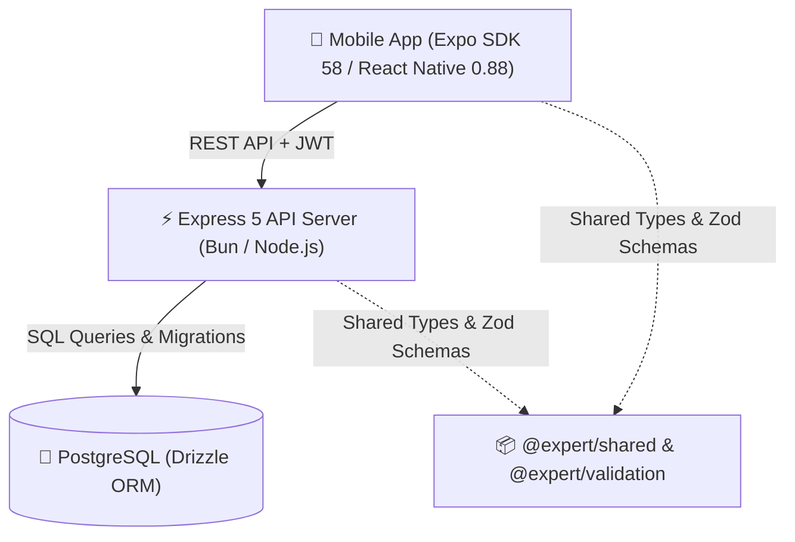

# 🎓 Expert Learning & Consultation Platform

A full-stack, production-grade monorepo for an **Expert Learning & 1-on-1 Consultation Platform** (inspired by the on-demand consultation marketplace model). Built with **React Native (Expo SDK 58)**, **Express 5**, **PostgreSQL**, **Drizzle ORM**, **Zod**, and **Turborepo**.

---

## 📑 Table of Contents

- [Overview & Architecture](#-overview--architecture)
- [Tech Stack](#-tech-stack)
- [Monorepo Structure](#-monorepo-structure)
- [Key Features](#-key-features)
- [Prerequisites](#-prerequisites)
- [Getting Started](#-getting-started)
  - [1. Installation](#1-installation)
  - [2. Environment Configuration](#2-environment-configuration)
  - [3. Database Setup, Migrations & Seeding](#3-database-setup-migrations--seeding)
  - [4. Running the Development Servers](#4-running-the-development-servers)
- [Demo Credentials](#-demo-credentials)
- [API Documentation & Endpoints](#-api-documentation--endpoints)
- [Scripts & Quality Assurance](#-scripts--quality-assurance)
- [Troubleshooting & Notes](#-troubleshooting--notes)

---

## 🏛 Overview & Architecture

The platform connects learners with verified subject-matter experts across disciplines (Computer Science, Mathematics, UI/UX Design, Physics, etc.). Learners can explore educator profiles, filter by ratings, rates, and availability, book 1-on-1 consultation slots with in-app wallet balance, message educators in real time, and manage their consultation bookings.



---

## 🛠 Tech Stack

### Mobile Client (`apps/mobile`)
- **Framework:** React Native 0.88 with **Expo SDK 58**
- **Navigation:** Expo Router 58 (file-based, typed routes)
- **State Management:** Zustand (client state) & TanStack Query v5 (server cache & optimistic updates)
- **Forms & Validation:** React Hook Form + Zod
- **Networking:** Axios with JWT auto-attachment & unified error handling
- **Storage:** Expo SecureStore (secure token persistence)
- **Icons & UI:** Lucide React Native, custom responsive design system

### Backend Server (`apps/server`)
- **Runtime:** Bun 1.4+ / Node.js 20+
- **Framework:** Express 5
- **Database & ORM:** PostgreSQL + Drizzle ORM
- **Authentication:** JWT with bcrypt password hashing
- **API Documentation:** Swagger / OpenAPI UI
- **Validation:** Zod request parsing & middleware

### Monorepo & Tooling
- **Package Manager:** pnpm 11 (workspaces with hoisted linker)
- **Monorepo Engine:** Turborepo 2
- **Linter & Formatter:** Biome 1.9
- **Type Checking:** TypeScript 5.8+ / 6.0+ strict mode

---

## 📂 Monorepo Structure

```text
expert-learning-platform/
├── apps/
│   ├── mobile/                    # React Native / Expo application
│   │   ├── src/
│   │   │   ├── app/               # Expo Router pages & navigation
│   │   │   │   ├── (auth)/        # Login & Registration screens
│   │   │   │   ├── (tabs)/        # Home, Explore, Bookings, Wallet, Profile
│   │   │   │   ├── educator/      # Educator detailed profile & slots
│   │   │   │   ├── booking/       # Booking confirmation flow
│   │   │   │   └── chat/          # 1-on-1 Consultation messaging
│   │   │   ├── components/        # Reusable UI widgets & modals
│   │   │   ├── constants/         # Theme tokens, spacing, API config
│   │   │   ├── services/          # Axios API clients
│   │   │   └── stores/            # Zustand authentication store
│   │   ├── metro.config.js        # Monorepo Metro bundler resolver
│   │   └── package.json
│   │
│   └── server/                    # Express backend API
│       ├── src/
│       │   ├── config/            # Environment variable loader
│       │   ├── database/          # Drizzle schema, migrations, and seed script
│       │   ├── docs/              # Swagger OpenAPI documentation
│       │   ├── middleware/        # JWT auth, error handler, Zod validators
│       │   ├── modules/           # Feature modules (auth, educators, bookings, wallet, chat)
│       │   ├── app.ts             # Express application setup
│       │   └── server.ts          # Server bootstrap
│       └── package.json
│
├── packages/
│   ├── shared/                    # Shared TypeScript types, interfaces, constants
│   ├── validation/                # Zod validation schemas
│   └── config/                    # Shared tsconfig bases
│
├── data/postgres/                 # Local PostgreSQL database cluster (git-ignored)
├── package.json                   # Root scripts & turbo tasks
├── pnpm-workspace.yaml            # Monorepo workspace configuration
├── turbo.json                     # Turborepo task pipeline
└── README.md
```

---

## 🌟 Key Features

1. **🔐 Authentication & Session Persistence:**
   - JWT authentication with secure persistence via `expo-secure-store`.
   - Automatic session restoration on app boot.
   - Guarded routes preventing unauthorized access.

2. **🧭 Educator Discovery & Multi-Param Filtering:**
   - Real-time search with debouncing.
   - Filter by subject, price range, star rating, and online availability.
   - Sort by highest rated, lowest price, or years of experience.

3. **📅 Real-Time Slot Booking:**
   - Interactive calendar slots for certified educators.
   - Atomic wallet balance verification and deduction within a database transaction.
   - Double-booking prevention and slot locking.

4. **💳 In-App Wallet System:**
   - Authoritative backend ledger with transaction records (`recharge`, `consultation_payment`, `refund`).
   - Quick recharge presets (₹100, ₹250, ₹500, ₹1000) and custom amounts.
   - Instant refund on consultation cancellation.

5. **💬 1-on-1 Consultation Chat:**
   - Dedicated chat rooms between students and educators.
   - Real-time message bubbles, timestamps, sender indicators, and history.

6. **📖 Interactive API Documentation:**
   - Live Swagger UI at `/api/docs` with request/response schemas.

---

## 📦 Prerequisites

Ensure you have the following installed on your machine:

- **Node.js**: `v20.x` or higher
- **Bun**: `v1.2+` (recommended for server) or Node.js
- **pnpm**: `v10.x` or `v11.x`
- **PostgreSQL**: `v15+` or `v16+` (or Docker for containerized Postgres)

---

## 🚀 Getting Started

### 1. Installation

Clone the repository and install dependencies using `pnpm`:

```bash
git clone https://github.com/your-repo/expert-learning-platform.git
cd expert-learning-platform
pnpm install
```

### 2. Environment Configuration

Create a `.env` file inside `apps/server/`:

```bash
cp apps/server/.env.example apps/server/.env
```

Default configuration in `apps/server/.env`:
```env
PORT=4000
NODE_ENV=development
DATABASE_URL=postgresql://postgres@localhost:5432/expert_learning
JWT_SECRET=expert_learning_super_secret_jwt_key_2026
JWT_EXPIRES_IN=7d
```

### 3. Database Setup, Migrations & Seeding

If using local PostgreSQL:
```bash
# 1. Create the database
createdb expert_learning

# 2. Run Drizzle table migrations
pnpm db:push

# 3. Seed demo educators, subjects, slots, and demo users
pnpm db:seed
```

*(Optional)* If you prefer Docker:
```bash
pnpm db:up     # Starts PostgreSQL container on port 5432
pnpm db:push   # Applies schema
pnpm db:seed   # Seeds data
```

### 4. Running the Development Servers

#### Concurrently (Both Server & Mobile):
```bash
pnpm dev
```

#### Individually:
```bash
# Start Backend Server (runs on http://localhost:4000)
pnpm dev:server

# Start Mobile Metro Bundler (Expo SDK 58)
pnpm dev:mobile
```

From the Expo CLI terminal:
- Press `w` to open in **Web browser**.
- Press `a` to run on connected **Android Emulator / Device**.
- Press `i` to run on **iOS Simulator**.
- Scan the displayed QR code with the **Expo Go** mobile app.

---

## 🔑 Demo Credentials

The database seed provides ready-to-use demo accounts:

| Role | Email | Password | Initial Balance |
| :--- | :--- | :--- | :--- |
| **Student** | `student@demo.com` | `password123` | ₹1,500 |
| **Educator** | `ananya@expert.com` | `password123` | ₹0 (Mentorship profile) |

---

## 📡 API Documentation & Endpoints

Once the backend server is running, explore the interactive **Swagger UI** at:
👉 **[http://localhost:4000/api/docs](http://localhost:4000/api/docs)**

### Key REST Endpoints

| Method | Endpoint | Description | Auth Required |
| :--- | :--- | :--- | :---: |
| `GET` | `/health` | Server health check | No |
| `POST` | `/api/auth/register` | Register new student or educator | No |
| `POST` | `/api/auth/login` | Login and obtain JWT token | No |
| `GET` | `/api/auth/me` | Fetch authenticated user profile | Yes |
| `GET` | `/api/subjects` | List all subjects & categories | No |
| `GET` | `/api/educators` | Query educators with search & filters | No |
| `GET` | `/api/educators/:id` | Fetch educator profile and slots | No |
| `GET` | `/api/educators/:id/slots` | Fetch available consultation slots | No |
| `POST` | `/api/bookings` | Book consultation slot (wallet deduct) | Yes |
| `GET` | `/api/bookings` | List user's consultation bookings | Yes |
| `PATCH` | `/api/bookings/:id/cancel` | Cancel consultation and process refund | Yes |
| `GET` | `/api/wallet` | Fetch current wallet balance | Yes |
| `POST` | `/api/wallet/recharge` | Add funds to user wallet | Yes |
| `GET` | `/api/wallet/transactions` | View wallet transaction history | Yes |
| `GET` | `/api/chats` | List user chat conversations | Yes |
| `GET` | `/api/chats/educator/:id` | Get or create chat room with educator | Yes |
| `GET` | `/api/chats/:id/messages` | Fetch messages for chat room | Yes |
| `POST` | `/api/chats/:id/messages` | Send message in consultation chat | Yes |

---

## 🧪 Scripts & Quality Assurance

Run verification scripts across the entire monorepo using Turborepo:

| Script | Command | Purpose |
| :--- | :--- | :--- |
| **Typecheck** | `pnpm check` | Runs `tsc --noEmit` across all 5 workspace packages |
| **Unit Tests** | `pnpm test` | Runs validation and logic tests |
| **Lint** | `pnpm lint` | Runs Biome linter check |
| **Format** | `pnpm format` | Auto-formats code with Biome |
| **Build** | `pnpm build` | Turbo build pipeline |
| **Export Web** | `pnpm --filter @expert/mobile exec expo export -p web` | Verifies full client bundling |

---

## 💡 Troubleshooting & Notes

- **Physical Device API Connection:** When connecting from a physical phone using Expo Go, make sure your phone and development computer are on the same Wi-Fi network. By default, `apps/mobile/src/constants/config.ts` auto-detects the host IP from `Constants.expoConfig.hostUri`.
- **Metro Cache Reset:** If encountering bundler caching glitches after switching branches:
  ```bash
  rm -rf /tmp/metro-* apps/mobile/.expo
  pnpm dev:mobile -- -c
  ```
- **Postgres Connections:** Ensure PostgreSQL is active on port `5432` before starting the server. Test connection using `psql -h localhost -U postgres -d expert_learning`.
